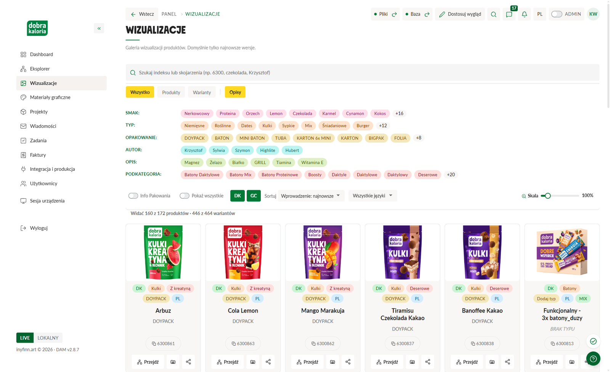
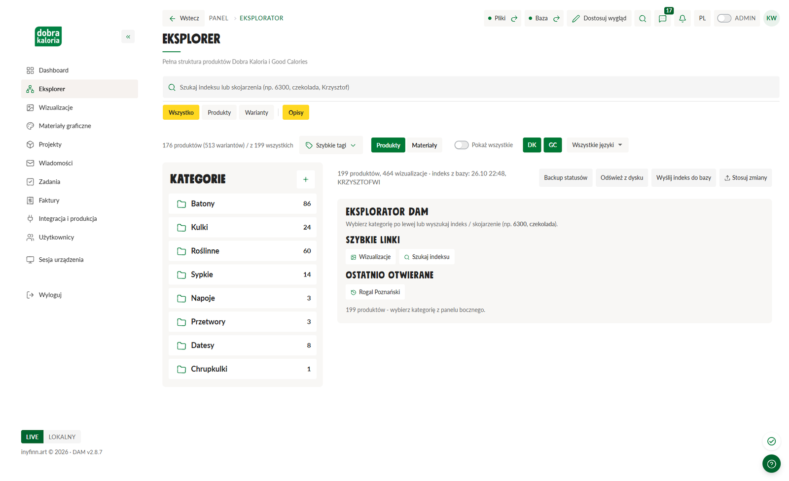
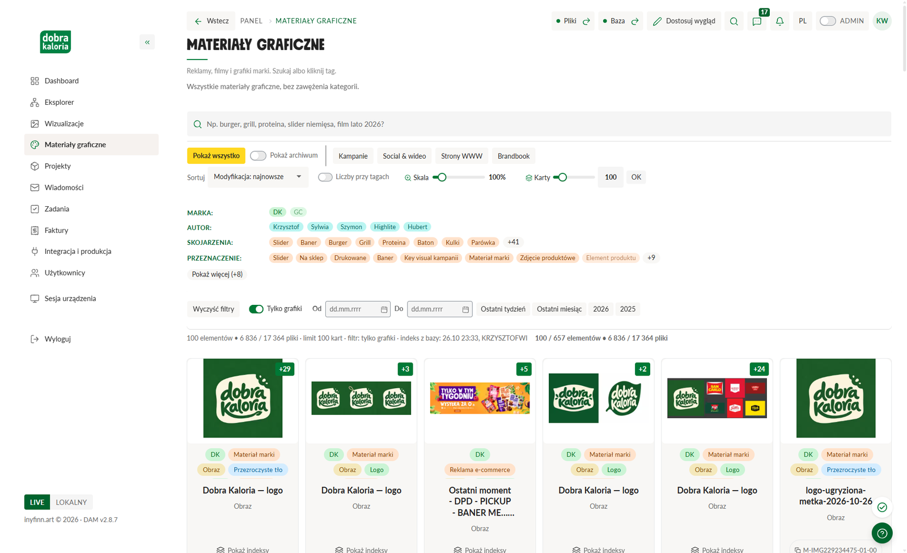
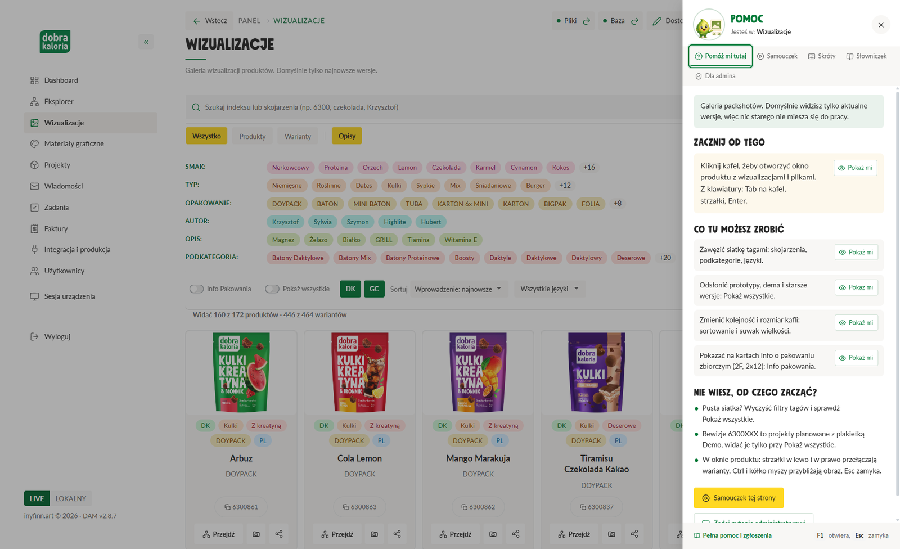

# DAM - Dobra Kaloria

**Program do pracy z materiałami marek Dobra Kaloria i Good Calories.** Jedno miejsce, w którym widać wszystkie produkty, ich wizualizacje, projekty opakowań i materiały graficzne, razem z tym, kto nad czym pracuje i na jakim etapie jest produkt. Działa na Windows i macOS, a dane trzyma w centralnej bazie, więc każdy komputer widzi to samo.

[**Pobierz najnowszą wersję**](https://github.com/inyfinn/DAM---Dobra-Kaloria---inyfinn/releases/latest) - Windows (`DAM-Setup.exe`), macOS (`DAM-AppleSilicon.dmg` dla procesorów M, `DAM-Intel.dmg` dla Intela).

## Co potrafi

### Wizualizacje
Galeria packshotów z domyślnym widokiem tylko najnowszych wersji, więc nic starego nie miesza się do pracy. Produkty filtrujesz tagami (smak, typ, opakowanie, autor, opis, podkategoria), sortujesz i skalujesz kafle. Kliknięcie otwiera okno produktu z wariantami, perspektywami (przód, tył), tłem i jakością pliku oraz powiązanymi materiałami.

### Eksplorer
Pełna struktura produktów z kategoriami po lewej: wiersze produktów, rewizje, nośniki opakowań (baton, kartonik, doypack, kulki, tuba i inne), statusy F / X / D (aktualny, nieaktualny, demo) oraz zmiana wersji jednym przyciskiem z listą. Szukasz po indeksie, nazwie albo skojarzeniu.

### Materiały graficzne
Reklamy, filmy, banery, loga i grafiki marki w jednym katalogu, z podziałem na kampanie, social i wideo, strony WWW oraz brandbook. Wyszukiwarka rozumie zwykłe zapytania ("slider niemięsa", "film lato 2026"), a tagi pozwalają zawęzić wynik kliknięciem. Pliki w kilku formatach (PNG, SVG) są jednym elementem, a SVG otwiera się w oknie podglądu.

### Pomoc w każdym miejscu
Znak zapytania (lub klawisz F1) otwiera panel "Pomóż mi tutaj": krótkie wskazówki dla bieżącej strony z przyciskami "Pokaż mi", które podświetlają element na ekranie, samouczek, lista skrótów klawiszowych i słowniczek. Dobrokaloriuś prowadzi przez program, a bez myszy da się przełączać strony (Alt+1...9), szukać (`/` albo Ctrl+K) i chodzić po kaflach klawiszami Tab i strzałkami.

### Pozostałe moduły
- **Dashboard** - liczniki produktów i projektów, najnowsze wizualizacje i produkty oraz powiadomienia z Asany i Teams, układane po swojemu.
- **Projekty, Zadania, Wiadomości** - projekty opakowań z etapami, zadania i skrzynka zgłoszeń (zapotrzebowanie na wizualizacje, uwagi).
- **Faktury, Integracja i produkcja** - faktury i koszty, integracje (Asana, Teams) oraz dane produkcyjne produktów.
- **Użytkownicy** (tylko administrator) - lista kont z wyszukiwaniem i filtrami, akceptacja nowych osób, kody aktywacyjne, klucze licencji, edycja i wyłączanie kont.
- **Profil i Ustawienia** - dane konta, komputery i ścieżki do folderu Marketing (każdy komputer może mieć inną literę dysku), motyw jasny i ciemny, zestawy kolorów.
- **LIVE i LOKALNY** - przełącznik źródła danych: wspólna baza albo tylko pliki z tego komputera.

## Jak to działa

- **Jedna prawda w bazie.** Konta, statusy, tagi i skojarzenia leżą w centralnej bazie PostgreSQL, a plik z dysku Marketing pozostaje źródłem materiałów. Pamięć podręczna miniatur przyspiesza podglądy, a oryginał jest zawsze do otwarcia.
- **Instaluj i pracuj.** Instalator zawiera wszystko, czego program potrzebuje: nie trzeba instalować Pythona ani niczego konfigurować. Po instalacji logujesz się kontem firmowym.
- **Aktualizacje same.** Program sprawdza to repozytorium i pobiera nowe wydanie w tle. Wydania są podpisane, więc program instaluje tylko to, co pochodzi od autora. Ręcznie: menu profilu, Sprawdź aktualizacje.
- **Szybki start.** Okno startowe pojawia się od razu, a ponowne kliknięcie ikony w trakcie uruchamiania nie restartuje programu.

## Repozytoria

- **Wydania (to repozytorium, publiczne):** instalatory i podpisy do pobrania. Programy na komputerach czytają stąd aktualizacje, dlatego nazwa tego repozytorium się nie zmienia.
- **Kod źródłowy:** `inyfinn/DAM-src` (prywatne).

## Licencja i autorzy

Oprogramowanie komercyjne. Autor: Krzysztof Marcin Wieczorek. Licencji udziela INYFINN ART sp. z o.o. (Katowice). Pełna umowa licencyjna wraz ze streszczeniem jest w instalatorze i w programie (strona Licencja). Program korzysta z motywu Geex i bibliotek open source na ich własnych licencjach.
